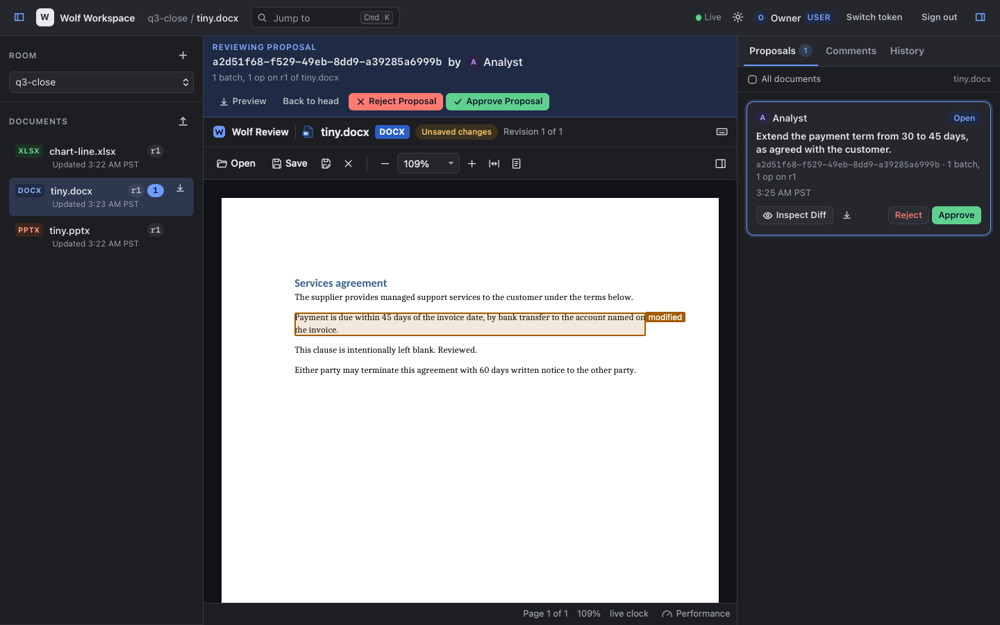

# Wolf Workspace

Wolf Workspace is a self-hosted place where a team and its AI agents edit and review Word, Excel
and PowerPoint files together. Documents live in shared rooms. People edit them in the browser.
Agents connect over the Model Context Protocol (MCP) and propose changes, a person approves or
rejects each proposal, and the room keeps every revision.



Start it with Docker:

```sh
git clone https://github.com/wolfsdk/workspace.git
cd workspace
docker compose up -d
docker compose logs workspace     # prints the address to sign in at
```

Open the printed address, create a room, and drop a DOCX, XLSX or PPTX file into it.

## What is open source and what is not

Wolf Workspace is not open source as a whole. The code in this repository is open source. The Wolf
engine that opens, edits, renders and saves every document is a closed binary.

|Part|Licence|
|---|---|
|This repository: the room server, the browser workspace, the MCP server, the pack engine, the CLI and the container image built from them|Apache-2.0|
|`@wolfsdk/protocol` and `@wolfsdk/review`|MIT|
|The Wolf engine: the `wolf` executable on the server and the `wolf_web` WebAssembly module in the browser|Closed source. Neither is in this repository or in the image.|

The engine is free of charge under the Community Self-Host grant: one workspace with up to five
signed-in seats, on your own infrastructure, with no licence key. Anything larger needs a
`WOLF_LICENSE_KEY`.

## Self-hosting

### With Docker

The four commands above are the whole install. The image (`ghcr.io/wolfsdk/workspace:0.1.0-2`) is
built for `linux/amd64` and `linux/arm64` and holds only this repository's code. On the first
start the container:

- installs the pinned Wolf engine (0.2.25) from `https://wolfsdk.com/install` into the data volume,
  under the Wolf Community Self-Host licence, and prints where it keeps the licence text
  (`bin/wolf-licenses/0.2.25/LICENSE-WOLF-COMMUNITY-SELFHOST.txt` in the volume). Later starts
  reuse it. To use your own `wolf` executable instead, mount it and name it with `WOLF_ENGINE`.
- creates one user, `Owner`, and prints that user's sign-in address to the log.

On an Apple Silicon Mac, Docker pulls the `linux/arm64` image and the container installs the
engine's arm64 Linux build, so neither the server nor the engine needs Rosetta or x86-64
emulation. On colima 0.10.3 with its default settings and its x86-64 emulation switched off, a
cold start took 11 s from `docker compose up -d` to a signed-in room, and a DOCX was uploaded,
edited and downloaded in the second after that. Docker Desktop has not been timed. An arm64 Linux
host needs no emulation either. A data volume that image 0.1.0-1 filled on an arm64 host holds the
x86-64 engine; the first start of this image replaces it with the arm64 build.

When the server crashes, or fails three health probes in a row (they run 10 s apart), the
container exits and Docker starts it again. A crashed server was answering again within 1 s, and
one that had stopped answering within 43 s.

Rooms, document blobs, the engine and the actor table (`actors.json`, a map of bearer token to
actor) live in the `workspace-data` volume. Browsers load the engine's WebAssembly module from
`https://wolfsdk.com/download/wolf`, so they need to reach that address.

The port binds to `127.0.0.1`. When the container runs on another machine, forward the port and
open the printed address on your own machine:

```sh
ssh -N -L 8787:127.0.0.1:8787 user@your-server
```

Put TLS in front before setting `WOLF_WORKSPACE_BIND=0.0.0.0`, because tokens travel in the clear
on plain HTTP.

### Add an agent

Everyone who connects, person or agent, is an entry in `actors.json`. To add an agent, write an
entry with a new token and restart:

```sh
docker compose exec -T workspace bun -e '
const file = "/data/actors.json";
const actors = JSON.parse(await Bun.file(file).text());
const token = crypto.randomUUID().replaceAll("-", "") + crypto.randomUUID().replaceAll("-", "");
actors[token] = { kind: "agent", id: "analyst", name: "Analyst", operator: { id: "owner", name: "Owner" } };
await Bun.write(file, JSON.stringify(actors, null, 2) + "\n");
console.log(token);
'
docker compose restart workspace
```

The first command prints the agent's token. An agent with an `operator` works on that person's
seat instead of taking its own. A person is the same kind of entry with `"kind": "user"` and no
`operator`, and signs in at `http://127.0.0.1:8787/?token=<their token>`.

Point an MCP client at `http://127.0.0.1:8787/mcp?room=<room>` (Streamable HTTP) and send the
token as `Authorization: Bearer <token>`. To check the connection by hand:

```sh
curl -s "http://127.0.0.1:8787/mcp?room=<room>" \
  -H "Authorization: Bearer <token>" \
  -H "Content-Type: application/json" \
  -H "Accept: application/json, text/event-stream" \
  -d '{"jsonrpc":"2.0","id":1,"method":"initialize","params":{"protocolVersion":"2025-03-26","capabilities":{},"clientInfo":{"name":"check","version":"0"}}}'
```

The agent gets eight tools (see [`packages/mcp`](packages/mcp)). What it writes with `doc_edit` in
`propose` mode waits in the room's Proposals panel until a person approves or rejects it. An agent
can never approve a proposal.

### Without Docker

With [Bun](https://bun.sh) 1.4 or later on Linux x86-64:

```sh
curl -fsSL https://wolfsdk.com/install | sh
mkdir -p blobs
TOKEN=$(openssl rand -hex 32)
printf '{"%s": {"kind": "user", "id": "owner", "name": "Owner"}}\n' "$TOKEN" > actors.json
echo "Sign in at http://127.0.0.1:8787/?token=$TOKEN"
bunx @wolfsdk/workspace@0.1.0 serve --db rooms.sqlite --blobs blobs --engine ~/.local/bin/wolf --actors actors.json
```

## Packages

|Path|Package|What it is|
|---|---|---|
|`packages/protocol`|`@wolfsdk/protocol`|The engine contract: request and reply types, operations, workspace room messages, the review session record (`wolfsdk.review-session.v1`), its JSON schema and validators. MIT; no runtime dependencies.|
|`packages/runtime`|`@wolfsdk/runtime`|The reactor client (worker in the browser, in-process in Node), the engine loader that resolves a module from the release channel and verifies its SHA-256, and the seal helpers. Apache-2.0.|
|`packages/review`|`@wolfsdk/review`|The `<wolf-review>` element that opens a DOCX, XLSX or PPTX, shows it and edits it through the engine, with an auto-registering entry, a React wrapper and the styles. Published to npm under MIT.|
|`packages/server`|`@wolfsdk/server`|Multi-party workspace rooms, SQLite append-only op log, content-addressed blob store, seat enforcement, and `wolf reactor-serve` worker pool. Apache-2.0.|
|`packages/mcp`|`@wolfsdk/mcp`|Model Context Protocol server (stdio and Streamable HTTP) exposing the 8 workspace tools and `wolf://workspace/{id}` resource. Apache-2.0.|
|`packages/packs`|`@wolfsdk/packs`|`pack.wolf.json` freshness check and refresh across DOCX bookmarks/tables and PPTX tables, headlines, and chart series from XLSX, CSV, and SQL snapshots. Apache-2.0.|
|`packages/workspace-cli`|`@wolfsdk/workspace`|The `wolfsdk-workspace` CLI (`check`, `refresh`, `serve`) over the workspace room server and pack engine. Apache-2.0.|
|`apps/workspace`|`@wolfsdk/workspace-app`|The browser workspace that `serve` and the container image ship: rooms, documents, the editor, proposals, comments and history. Apache-2.0. Never published on its own; `@wolfsdk/workspace` carries the build.|
|`apps/playground`|`@wolfsdk/playground`|A local page that mounts the element beside the inspection modes. Never published.|

Nothing here reimplements format logic: the element and the server both call the engine.
`@wolfsdk/review` bundles what it needs from `@wolfsdk/protocol` and `@wolfsdk/runtime` and
publishes from `packages/review/dist`.

`@wolfsdk/protocol`, `@wolfsdk/server`, `@wolfsdk/mcp`, `@wolfsdk/packs` and `@wolfsdk/workspace`
publish to npm as TypeScript source for Bun 1.4 or later; `@wolfsdk/workspace` carries the compiled
browser UI. `bun run pack` stages each of the five with its publish manifest and writes the tarballs
and `SHA256SUMS` to `pack/`; `bun run pack:check` also installs them into an empty project and
refuses them unless every export loads, the declarations compile and the CLI starts.
`@wolfsdk/runtime` is not published on its own: it reaches its worker and the engine module by
paths of this workspace, and reaches users inside `@wolfsdk/review` and the workspace UI.

## Commands

Run from the repository root with [Bun](https://bun.sh) 1.4 or later.

```sh
bun install
bun run typecheck      # tsc for every package and app
bun test               # unit tests for every package and app
bun run build          # build @wolfsdk/review into packages/review/dist
bun run check          # typecheck, tests, then the @wolfsdk/review package check
bun run gate           # frozen install, then check: the one command a lane gate runs from a clean checkout
```

Two checks need an engine module (see below):

```sh
bun run --cwd packages/runtime smoke    # open, edit, save and export a session for DOCX, XLSX, PPTX
bun run --cwd apps/playground dev       # the playground on http://localhost:5410
```

The package check (`packages/review/scripts/check.ts`) builds and packs the tarball, then
refuses it unless it carries the MIT licence, holds no `.wasm`, source map or source file,
defaults to the release channel, and its declarations compile in a consumer project.

## The engine module

`@wolfsdk/review` never bundles the engine. At run time it fetches the module from the release
channel (`https://wolfsdk.com/download/wolf` by default), or from an exact URL given with its
SHA-256, and verifies the bytes before compiling them. The module's licence is separate from
this workspace's licences.

For local work, put a module at `vendor/wolf_web.wasm`. The directory is ignored by
Git: a module is tens of megabytes and is never committed or packed.


The smoke script and the playground's dev server read `vendor/wolf_web.wasm`; the unit tests
need no module. A module that lacks an optional command answers `unsupported`; the element
reports the refusal and disables the control that issued it for the rest of the session.

The module on the release channel (0.2.25) applies the element's editing operations: typing in
a DOCX paragraph, typing in a PPTX shape and setting an XLSX cell were run against it on
2026-11-14. A module built from `main` on 2026-11-13 opens, renders, saves and exports sessions
for all three formats and applies the engine's Agent API operations (`set`, `replace-text`,
`insert`, `delete`, `format` and the rest), but still refuses the operations the element's
editors add on top: typing in a DOCX (`splice-text`, `split-paragraph`, `join-paragraph`,
`set-list`), moving and resizing a PPTX shape, and the XLSX grid operations. Those controls
report the refusal. The smoke script uses one operation per format that a module from `main`
accepts.

## Fixtures

`fixtures/` holds one small file per format for the smoke script. Tests that need recorded
engine replies keep them beside the test.
